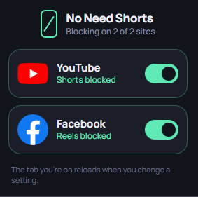

# No Need Shorts

A personal project to create a simple extension that restricts YouTube Shorts and Facebook Reels from appearing in your feed. This extension is designed to help users focus on longer content and avoid the distractions of short-form videos.

## Preview

## Stack
- [WXT Framework](https://wxt.dev/)
- React
- TypeScript

## How to build
1. Clone the repository
2. Run `npm install` to install dependencies
3. Run `npm run bp` to build and package the extension
4. Load the extension from `.output` folder in your browser's extension settings 
